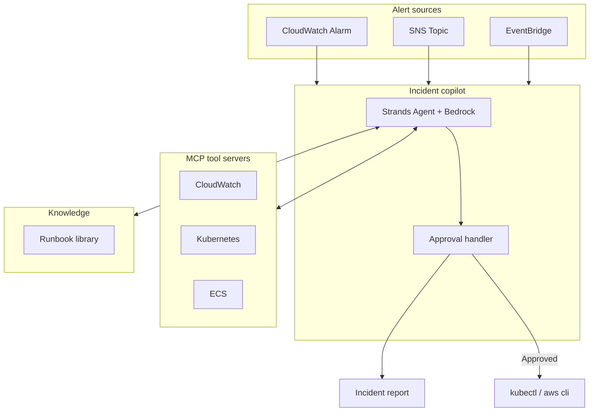
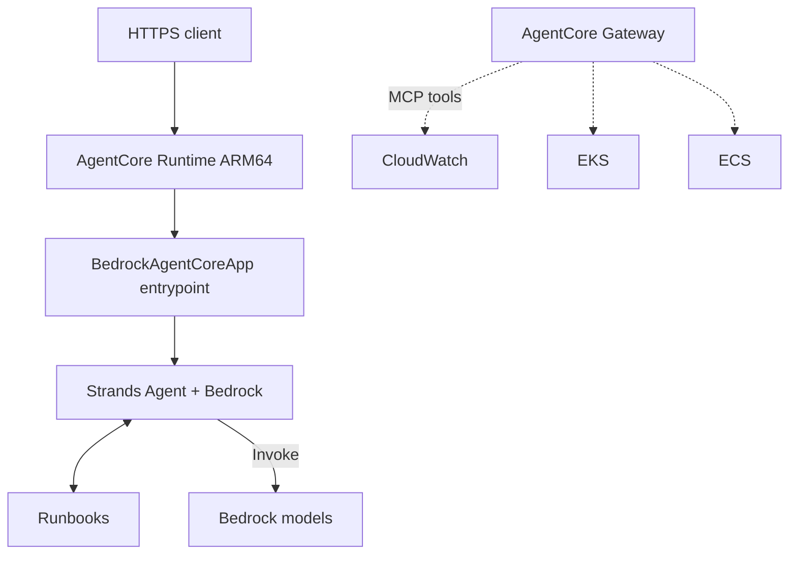

# AWS Incident Copilot

[](https://github.com/harin-singh/aws-incident-copilot/actions/workflows/ci.yml)
[](LICENSE)
[](https://www.python.org/downloads/)

A Strands Agents + Amazon Bedrock agent that investigates EKS and ECS incidents with MCP tools, writes a structured report, and proposes remediations that do not run until a human approves them.

I built this because most of my incident time went into the same first fifteen minutes: pull logs, check events, match a runbook, draft a fix. The agent does that loop. It does not push a change without you.

## What it does

1. Takes an alert (CrashLoopBackOff, ECS OOM, ALB 5xx, or a custom payload).
2. Queries CloudWatch, Kubernetes, and ECS through three MCP servers.
3. Searches a small runbook library with keyword matching.
4. Returns a report: timeline, evidence, root cause, confidence, and proposed actions.
5. Waits for approval before any remediation command runs.

Demo mode uses fixture data and a scripted model stub, so you can run the full flow with no AWS credentials.

## Architecture

### Local / CLI



### AgentCore deployment (optional)



Terraform for AgentCore sits behind `enable_agentcore = false` by default. Gateway tool targets that need per-tool Lambdas are documented but not shipped yet.

## Quick start

```bash
git clone https://github.com/harin-singh/aws-incident-copilot.git
cd aws-incident-copilot
python -m venv .venv
source .venv/bin/activate
pip install -e ".[dev]"
# or: make install-dev

make demo
# scenarios: crashloop | oom | alb-5xx
python -m aws_incident_copilot.cli demo --scenario crashloop
python -m aws_incident_copilot.cli scenarios
```

Needs Python 3.11+. Live mode needs AWS credentials and Bedrock model access in the region you use.

## Design choices

- Separate IAM roles for investigation (read-only) and remediation. Remediation stays off unless you turn it on.
- Log and event content is treated as untrusted input so a poisoned log line cannot become a command.
- Keyword runbook search first. It is deterministic and easy to test. Semantic search with Bedrock Knowledge Bases is on the roadmap.
- Approval is CLI-only today. Slack and Step Functions are not wired yet.
- MCP keeps the tools swappable: fixtures in demo mode, boto3/kubectl in live mode, AgentCore Gateway later.

## Tests and CI

```bash
make test
make test-cov
pytest tests/unit -v
```

GitHub Actions runs ruff, mypy, pytest, gitleaks, checkov, and pip-audit on every push to main. The badge above points at that workflow.

## Deploy and cost

Local/CLI with light use: roughly $5–15 per month (CloudWatch queries + Bedrock tokens).

AgentCore with about 100 investigations per month and 30-second sessions: roughly $15–50 per month in us-west-2. Assumptions are in the Terraform docs.

```bash
cd terraform
cp variables.tfvars.example terraform.tfvars
terraform init
terraform plan
terraform apply
# teardown
terraform destroy
```

Set `enable_agentcore = true` only after you have an ARM64 image in the ECR repo Terraform creates. See the Terraform README for the build and push steps.

## Limits

- Live Bedrock calls need model access; demo mode does not call Bedrock.
- Runbook search is keyword-only.
- Approval is CLI-only.
- Remediation execution is stubbed in demo mode.
- AgentCore Gateway MCP tool Lambdas are documented, not implemented.
- This has been exercised in CI and demo mode. It has not been run as a production pager duty bot on a live multi-account estate.

## What I'd change next

- TODO: semantic runbook search with Bedrock Knowledge Bases
- TODO: Slack (or similar) approval instead of CLI-only
- TODO: ship the Gateway Lambda adapters for the three MCP servers
- TODO: wire PagerDuty or OpsGenie as an alert source
- TODO: (your call) multi-cluster discovery and a tagged `v0.1.0` release

## License

MIT. See [LICENSE](LICENSE).
