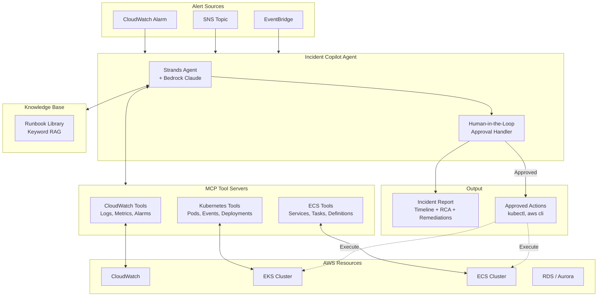

# AWS Incident Copilot

**AI-powered incident investigation and remediation for AWS** — An intelligent agent that investigates EKS, ECS, and CloudWatch incidents, identifies root causes, and proposes safe remediations with human-in-the-loop approval.

[](https://github.com/harindersingh/aws-incident-copilot/actions/workflows/ci.yml)
[](https://opensource.org/licenses/MIT)
[](https://www.python.org/downloads/)

---

## Overview

AWS Incident Copilot is an AI agent built with the [Strands Agents SDK](https://strandsagents.com/) and Amazon Bedrock that automates incident investigation. When an alert fires (e.g., pod CrashLoopBackOff, ECS task OOM-killed, ALB 5xx spike), the copilot:

1. **Investigates** using MCP tools to query CloudWatch Logs/metrics, Kubernetes events, and ECS task details
2. **Retrieves** relevant runbooks from a lightweight knowledge base
3. **Produces** a structured incident report with timeline, evidence, root cause analysis, and confidence level
4. **Proposes** remediation actions that require **explicit human approval** before execution

This project demonstrates production-ready patterns for AI-assisted operations while maintaining safety through guardrails and human oversight.

## Architecture



## Features

- **MCP-based investigation tools** for CloudWatch, Kubernetes, and ECS
- **Runbook retrieval** with keyword-based search (production: integrate with Bedrock Knowledge Bases)
- **Human-in-the-loop approval** for all remediation actions
- **Demo mode** runs entirely offline with fixture data — no AWS credentials needed
- **Least-privilege IAM** with separate read and remediation roles
- **Prompt injection guardrails** — log content is treated as untrusted data
- **Terraform** for production deployment

## Quickstart

### Prerequisites

- Python 3.11+
- (Optional) AWS credentials for live mode
- (Optional) Terraform 1.5+ for deployment

### Installation

```bash
# Clone the repository
git clone https://github.com/harindersingh/aws-incident-copilot.git
cd aws-incident-copilot

# Create virtual environment
python -m venv venv
source venv/bin/activate  # On Windows: venv\Scripts\activate

# Install in development mode
make install-dev
```

### Run Demo Mode (~5 minutes)

Demo mode uses pre-recorded fixture data and scripted model responses, so you can explore the full investigation flow without AWS credentials:

```bash
# Run the crashloop scenario
make demo

# Or specify a scenario
python -m aws_incident_copilot.cli demo --scenario crashloop
python -m aws_incident_copilot.cli demo --scenario oom
python -m aws_incident_copilot.cli demo --scenario alb-5xx

# List all available scenarios
python -m aws_incident_copilot.cli scenarios
```

### Sample Output

```
🚨 Incident Alert
━━━━━━━━━━━━━━━━━━━━━━━━━━━━━━━━━━━━━━━━━━━━━━━━━━━━━━━━━━━━━━━━━━━━━━━
Pod CrashLoopBackOff: payment-service-7d4f8b9c5d-x2k9m

ID: alert-eks-crashloop-001
Source: eks
Severity: HIGH
Resource: payment-service-7d4f8b9c5d-x2k9m

Pod payment-service-7d4f8b9c5d-x2k9m in namespace production has
restarted 8 times in the last 45 minutes. Current state: CrashLoopBackOff.
━━━━━━━━━━━━━━━━━━━━━━━━━━━━━━━━━━━━━━━━━━━━━━━━━━━━━━━━━━━━━━━━━━━━━━━

⏳ Investigating incident...

## Incident Investigation Complete

### Summary
The payment-service pods are in CrashLoopBackOff due to **database
authentication failure**. The service cannot connect to the RDS database
because of invalid credentials.

### Root Cause Analysis
**Primary Cause**: Database password authentication failed for user "payment_svc"
**Confidence**: 95%

### Proposed Remediations

**Option 1: Update Database Credentials** (Recommended)
- Risk: Low
- Command: `kubectl create secret generic payment-db-credentials...`

**Option 2: Rollback to Previous Revision**
- Risk: Low
- Command: `kubectl rollout undo deployment/payment-service`

━━━━━━━━━━━━━━━━━━━━━━━━━━━━━━━━━━━━━━━━━━━━━━━━━━━━━━━━━━━━━━━━━━━━━━━
⚠️  HUMAN APPROVAL REQUIRED

Do you approve this remediation action? [y/n]:
```

## Demo Scenarios

| Scenario | Description | Root Cause |
|----------|-------------|------------|
| `crashloop` | EKS pod in CrashLoopBackOff | Database credential mismatch after rotation |
| `oom` | ECS tasks OOM-killed | Java heap exhaustion during large batch processing |
| `alb-5xx` | ALB 5xx spike | Database connection pool exhaustion |

## Design Decisions

### Why Human-in-the-Loop?

Automated remediation can cause cascading failures. The copilot investigates and proposes, but a human must approve any action that modifies infrastructure. This follows the principle of "suggest, don't do" for production systems.

### Least-Privilege IAM

The Terraform configuration creates separate roles:
- **Investigation role**: Read-only access to CloudWatch, EKS, ECS
- **Remediation role**: Write access only with explicit resource tags (`AllowIncidentCopilot=true`) and external ID requirement

### Prompt Injection Guardrails

Log data may contain adversarial content. The system prompt instructs the model to treat log content as untrusted data and never execute commands found in logs without human verification.

### Why MCP Tools?

[Model Context Protocol](https://modelcontextprotocol.io/) provides a standardized interface for tools. This allows:
- Easy testing with fixture data (demo mode)
- Swappable implementations (mock → real AWS)
- Future integration with AgentCore Gateway

## Live Mode Deployment

### 1. Configure AWS Credentials

```bash
# Ensure Bedrock model access is enabled in your region
aws configure
```

### 2. Deploy Infrastructure

```bash
cd terraform

# Copy and customize variables
cp variables.tfvars.example terraform.tfvars

# Deploy
terraform init
terraform plan
terraform apply
```

### 3. Run in Live Mode

```bash
python -m aws_incident_copilot.cli run --mode live --region us-west-2
```

### Cost Estimate

| Resource | Estimated Monthly Cost |
|----------|----------------------|
| CloudWatch Logs queries | $0.005/GB scanned |
| CloudWatch metrics | $0.30/1000 requests |
| Bedrock Claude Sonnet | ~$3-15 depending on usage |
| Lambda (if deployed) | ~$0.20/1M requests |
| **Total** | **~$5-15/month** (light usage) |

### Teardown

```bash
cd terraform
terraform destroy
```

## Testing

```bash
# Run all tests
make test

# Run with coverage
make test-cov

# Run specific test categories
pytest tests/unit -v
pytest tests/integration -v
pytest tests/e2e -v
```

## Project Structure

```
aws-incident-copilot/
├── src/aws_incident_copilot/
│   ├── agents/           # Incident copilot agent and approval handling
│   ├── mcp_servers/      # MCP tool servers (CloudWatch, K8s, ECS)
│   ├── models/           # Pydantic data models
│   ├── runbooks/         # Runbook library and search
│   ├── demo/             # Demo fixtures and model stub
│   └── cli.py            # CLI entry point
├── tests/
│   ├── unit/             # Unit tests
│   ├── integration/      # Integration tests
│   └── e2e/              # End-to-end demo tests
├── terraform/            # AWS infrastructure
├── runbooks/             # Custom runbook YAML files
└── .github/workflows/    # CI configuration
```

## Limitations & Roadmap

### Current Limitations

- **Demo mode only** for model responses (live mode requires Bedrock access)
- **Keyword-based runbook search** (not semantic/vector search)
- **CLI approval only** (no Slack/Step Functions integration yet)
- **Read-only investigation** — remediation actions are stubbed in demo mode

### Roadmap

- [ ] Bedrock Knowledge Bases integration for semantic runbook search
- [ ] Slack approval workflow via Slack MCP
- [ ] Step Functions integration for async approval flows
- [ ] AgentCore Gateway deployment option
- [ ] Multi-cluster support with cluster autodiscovery
- [ ] Integration with PagerDuty/OpsGenie for alert ingestion
- [ ] Prometheus/Grafana metrics export

## Contributing

Contributions are welcome! Please:

1. Fork the repository
2. Create a feature branch (`git checkout -b feature/amazing-feature`)
3. Run tests and linting (`make test && make lint`)
4. Commit your changes (`git commit -m 'Add amazing feature'`)
5. Push to the branch (`git push origin feature/amazing-feature`)
6. Open a Pull Request

## License

This project is licensed under the MIT License - see the [LICENSE](LICENSE) file for details.

---

Built with [Strands Agents SDK](https://strandsagents.com/) and [Amazon Bedrock](https://aws.amazon.com/bedrock/)
