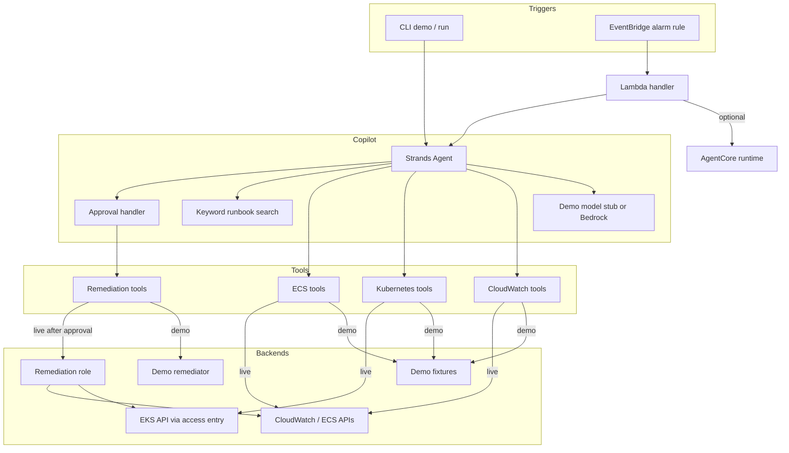

# AWS Incident Copilot

CLI and optional AgentCore runtime that investigates EKS, ECS, and CloudWatch incidents with Strands tools, then proposes remediations that require human approval before they run.

[](https://github.com/harin-singh/aws-incident-copilot/actions/workflows/ci.yml)
[](https://opensource.org/licenses/MIT)
[](https://www.python.org/downloads/)

## What actually works

A clone + `make demo` (or `python -m aws_incident_copilot.cli demo --scenario <name>`) does the following offline, with no AWS credentials:

1. Registers CloudWatch, Kubernetes, and ECS investigation tools as Strands `@tool` wrappers.
2. Runs a scripted model that **calls those tools** against fixture data for the chosen scenario.
3. Emits a root-cause write-up only if the tool results contain the expected evidence. If tools fail or return nothing useful, the run is marked `UNGROUNDED` and the CLI exits non-zero.
4. Remediation tools still require approval. After approval they execute against an in-memory demo backend and return `simulated` or `dry_run` — never `executed` for a no-op.

Live mode (`incident-copilot run --mode live --alert-file alert.json`) uses boto3 and the Kubernetes client. That path is implemented and unit-tested with moto / a fake k8s API. It is not exercised by CI against a real account.

## Architecture



### Trigger path

Terraform creates an EventBridge rule on CloudWatch alarm state changes and attaches a Lambda target. The Lambda parses the event and either:

- invokes an AgentCore runtime when `AGENTCORE_RUNTIME_ARN` is set, or
- runs `IncidentCopilot` in-process when the package is on the image/layer.

The zip artifact is a thin invoker. Full in-process investigation needs the container image (same image AgentCore uses) or a layer that includes this package.

## Demo

```bash
git clone https://github.com/harin-singh/aws-incident-copilot.git
cd aws-incident-copilot
python -m venv venv
source venv/bin/activate
make install-dev

make demo
# or
python -m aws_incident_copilot.cli demo --scenario crashloop
python -m aws_incident_copilot.cli demo --scenario oom
python -m aws_incident_copilot.cli demo --scenario alb-5xx
python -m aws_incident_copilot.cli scenarios
```

| Scenario | Tools the stub calls | Evidence the RCA requires |
|----------|----------------------|---------------------------|
| `crashloop` | `describe_pod`, `get_events`, `get_pod_logs`, `describe_deployment`, `describe_alarms` | `CrashLoopBackOff`, `password authentication failed` |
| `oom` | `describe_service`, `describe_stopped_tasks`, `get_metrics`, `describe_task_definition`, `query_logs` | `137`, `OutOfMemory` |
| `alb-5xx` | `get_metrics`, `query_logs`, `describe_alarms` | `Too many connections`, `HTTPCode_Target_5XX` |

CI runs every scenario through the CLI and fails on `tool not found`, `UNGROUNDED`, a traceback, or a crash.

## Remediation

After approval:

- **Demo**: mutates an in-memory store and returns `status=simulated` (or `dry_run`).
- **Live Kubernetes**: patches the deployment (`restartedAt` annotation) or rolls back to a previous ReplicaSet. Use `--dry-run` to validate only.
- **Live ECS**: `UpdateService` for desired count or `forceNewDeployment`, optionally after `sts:AssumeRole` onto the remediation role.

Denied actions return `status=not_executed`.

## Terraform

```bash
cd terraform
cp variables.tfvars.example terraform.tfvars
terraform init
terraform plan
```

What the root module creates:

- Investigation role assumed by Lambda, with read APIs plus Bedrock **inference profile** invoke.
- Remediation role assumable only by the investigation role. Same-account trust uses `aws:PrincipalArn` / `aws:SourceAccount`. `remediation_external_id` is optional and intended for cross-account use.
- EventBridge rule → Lambda (`incident-copilot-<env>-handler`) with a DLQ.
- EKS access entries when `eks_cluster_names` is set: `AmazonEKSViewPolicy` for investigation, `AmazonEKSEditPolicy` (namespace-scoped by default) for remediation.
- Optional AgentCore module (`enable_agentcore = true`), which requires AWS provider `>= 6.18.0`.

Default model id is the US geographic inference profile `us.anthropic.claude-sonnet-4-5-20250929-v1:0`. IAM allows that profile plus the foundation-model ARNs in `us-east-1`, `us-east-2`, and `us-west-2`. Enable model access in those regions before using live Bedrock.

### AgentCore (optional)

Build and push the ARM64 image, set `enable_agentcore = true`, then apply. Invoke with:

```bash
aws bedrock-agentcore invoke-agent-runtime \
  --agent-runtime-arn "$(terraform output -raw agentcore_runtime_arn)" \
  --payload '{"alert_type":"eks-crashloop","title":"Pod CrashLoopBackOff"}' \
  --region us-west-2
```

## Security notes

- Investigation is read-only. Writes go through the remediation role after approval.
- Prompt text tells the model to treat log bodies as untrusted.
- Documented Checkov skips: `CKV_AWS_355` (Describe/List on `*`), `CKV_AWS_158` / `CKV_AWS_338` (optional log KMS / 30-day retention), `CKV_AWS_117` / `CKV_AWS_173` (Lambda not in VPC, env vars are not secrets).

## Testing

```bash
make test
make test-cov
pytest tests/e2e -v
```

Unit tests cover live CloudWatch/ECS via moto, Kubernetes via a fake API, remediation execution, and model grounding. CI coverage floor is 70%.

## Known limitations

- **Demo model is not Bedrock.** It is a deterministic stub. It does call the real tool implementations and will refuse an RCA if those tools do not return the expected evidence.
- **Live Bedrock is opt-in.** `run --mode live` requires credentials, model access on the inference profile, and `--alert-file`. CI does not call AWS.
- **Runbook search is keyword matching**, not a Bedrock Knowledge Base.
- **Approval is CLI-only.** No Slack or Step Functions waiter.
- **Lambda zip is an invoker**, not a full copy of the agent. In-process investigation from EventBridge needs the container image or a layer.
- **EKS RBAC is access-entry based** (`AmazonEKSViewPolicy` / `AmazonEKSEditPolicy`). There is no custom Role YAML. Empty `eks_cluster_names` creates no access entries.
- **ECS writes are tag-gated** (`AllowIncidentCopilot=true`). Untagged services are denied by IAM even after approval.
- **Cross-region inference** needs foundation-model access in every destination region of the geographic profile.

## Project layout

```
src/aws_incident_copilot/
  agents/          # Copilot + approval
  tools/           # Strands @tool implementations
  remediation/     # Demo + live backends
  mcp_servers/     # MCP wrappers over the same impls (AgentCore Gateway)
  demo/            # Fixtures and grounded model stub
  lambda_handler.py
  cli.py
terraform/         # IAM, EventBridge -> Lambda, EKS access, optional AgentCore
tests/
```

## License

MIT. See [LICENSE](LICENSE).
